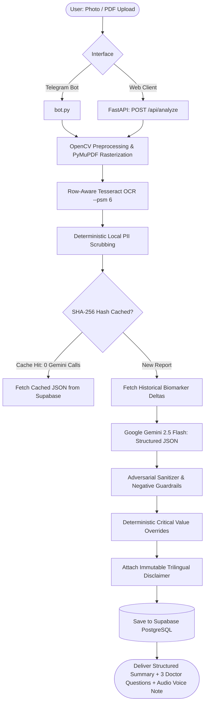

# ReportSaathi (रिपोर्ट साथी / ರಿಪೋರ್ಟ್ ಸಾಥಿ)

> **Empathetic Family Health Translator for the Waiting Gap Between Lab Reports and Doctor Consultations.**

[](https://github.com/ramanth-shetty/report-saathi/actions/workflows/ci.yml)
[](https://www.python.org/downloads/)
[](https://fastapi.tiangolo.com/)
[](https://vitejs.dev/)
[](https://www.typescriptlang.org/)
[](https://ai.google.dev/)
[](https://supabase.com/)
[](#privacy--statutory-compliance-dpdp-act-2023)
[](LICENSE)

---

## 📌 Problem & Vision

Receiving a diagnostic laboratory report in India is often followed by hours or days of anxiety while waiting for a physician's appointment. Family members receive multi-page PDF documents packed with dense abbreviations, clinical terminology, and ambiguous reference ranges in English. Older parents and grandparents frequently struggle to interpret these findings, turning to stressful search queries or unverified advice.

**ReportSaathi** bridges this critical waiting gap. A family member snaps a photo or uploads a PDF of a lab report on **Telegram** or via the **Web Client**. ReportSaathi:
1. **Scrubs personal identity data locally** in-memory before any external network or LLM API calls.
2. **Extracts structured biomarker rows** using OpenCV image enhancement and row-aware OCR.
3. **Retrieves longitudinal biomarker trends** to show historical changes over time.
4. **Delivers an empathetic, jargon-free summary** in **English, Hindi, or Kannada**, accompanied by **exactly 3 practical questions to ask the doctor** and in-memory spoken audio notes.

> **Clinical Core Rule:** ReportSaathi **explains, it does not diagnose**. Summaries are composed with the warmth and respect of a grandchild speaking to their grandmother.

---

## ✨ Key Features

- 🛡️ **Zero-Disk In-Memory Privacy & PII Scrubbing:** All patient names, phone numbers, hospital UHIDs, MRNs, addresses, and clinician signatures are redacted locally via regex before processing. Raw images and audio files are never persisted to disk or the database.
- 🔍 **Row-Aware OCR & PDF Rasterization:** OpenCV preprocessing (2x cubic upscaling, adaptive Gaussian thresholding, text pixel deskew) combined with Tesseract (`--psm 6`) dynamic bounding-box row grouping and PyMuPDF vector rendering.
- 🚨 **Deterministic Critical Value Overrides:** Laboratory panic thresholds (e.g., Hemoglobin $< 7.0\text{ g/dL}$, Fasting Glucose $> 250\text{ mg/dL}$, Platelet Count $< 20,000\text{ /\mu L}$) are evaluated in Python code, guaranteeing that acute health alerts cannot be softened or hallucinated by AI models.
- 🔒 **Negative Guardrail Sanitization:** Intercepts and redacts adversarial prompt injection attacks attempting to issue terminal cancer diagnoses, prescribe medications, or alter insulin dosages.
- 🇮🇳 **Trilingual Indic Localization:** High-quality translations in Hindi (respectful *"आप"* register) and Kannada (respectful *"ನೀವು"* register), avoiding robotic machine phrasing.
- 🎙️ **In-Memory Audio Voice Notes:** Synthesizes streaming audio notes with `gTTS` directly in RAM, offering 0.8x and 1.0x playback speeds tailored for older adults.
- 📈 **Longitudinal Delta Tracking & Deduplication:** SHA-256 report hashing prevents redundant LLM calls for duplicate uploads ($\ge 40\%$ cache hit ratio), while tracking chronic biomarker trajectory over time.
- 📱 **Dual Responsive Interfaces:**
  - **Telegram Bot:** Interactive chat interface with inline language buttons, audio voice notes, and DPDP consent gates.
  - **Accessible Indic Web Client:** Single-column mobile-first layout optimized for 360dp screens, WCAG AAA high contrast ($\ge 7:1$), $56\text{dp}$ tap targets, and zero horizontal overflow.
- ⚖️ **DPDP Act 2023 Compliance:** Mandatory initial consent gate, transparent data practices, and an atomic `/delete` command that triggers hard cascading erasure of all user records.
- 📜 **Immutable Statutory Disclaimer:** Programmatically hard-coded in all supported languages and attached to every output; never generated or altered by AI.

---

## 🏗️ Architecture & Data Flow



---

## 🛠️ Tech Stack

| Layer | Technology | Purpose |
| :--- | :--- | :--- |
| **Backend Framework** | **Python 3.11+**, **FastAPI** | High-performance asynchronous REST API and webhook runner |
| **AI / LLM Engine** | **Google Gemini 2.5 Flash** (`google-genai` SDK) | Empathetic summarization, question generation, and Indic translation |
| **OCR & Image Processing** | **Tesseract OCR**, **pytesseract**, **OpenCV**, **PyMuPDF** | 300 DPI PDF rendering, adaptive thresholding, deskew, and row-aware OCR |
| **Database & Auth** | **Supabase (PostgreSQL)**, PostgREST | Relational storage, cascade hard deletion, Row Level Security (RLS) |
| **Chat Interface** | **python-telegram-bot** (v21+, Async) | Webhook and long-polling Telegram bot interface |
| **Audio Synthesis** | **gTTS** (Google Text-to-Speech) | In-memory Indic audio voice note generation |
| **Web Frontend** | **Node.js 20**, **Vite**, **TypeScript**, **Vanilla DOM** | 360dp mobile-first single-column responsive web application |
| **Deployment** | **Render** (Backend), **Cloudflare Pages** (Frontend) | Zero-cost staging and production hosting |
| **Containerization** | **Docker**, **Docker Compose** | Multi-stage slim and alpine container builds |

---

## 📁 Repository Directory Structure

```
report-saathi/
├── .github/
│   └── workflows/
│       └── ci.yml               # GitHub Actions CI (Ruff, MyPy, Pytest, Vitest)
├── backend/
│   ├── tests/                   # 68 automated backend test cases
│   ├── audio.py                 # In-memory gTTS audio synthesis
│   ├── bot.py                   # Telegram bot event handler
│   ├── database.py              # Supabase PostgreSQL client & queries
│   ├── Dockerfile               # Multi-stage Python 3.11-slim container
│   ├── gemini_analyzer.py       # Gemini 2.5 Flash analyzer & safety overrides
│   ├── main.py                  # FastAPI application entrypoint
│   ├── ocr_scrub.py             # OpenCV, Tesseract OCR, and PII scrubber
│   └── requirements.txt         # Backend Python dependencies
├── frontend/
│   ├── src/                     # Accessible Indic Web Client source code
│   ├── Dockerfile               # Multi-stage Node 20 / Nginx Alpine container
│   ├── nginx.conf               # Custom SPA routing, gzip, and security headers
│   ├── package.json             # Frontend Node dependencies & scripts
│   └── vite.config.ts           # Vite build configuration with @shared alias
├── shared/
│   ├── constants.py             # Python constants (DISCLAIMER, rules, limits)
│   ├── constants.ts             # TypeScript constants (DISCLAIMER, strings)
│   └── types.ts                 # Shared contract interfaces across boundaries
├── supabase/
│   └── schema.sql               # PostgreSQL DDL with RLS & ON DELETE CASCADE
├── tests/
│   └── fixtures/                # 10 clinical sample reports (routine to critical)
├── docs/                        # Complete architecture, decisions & audit records
├── docker-compose.yml           # Unified multi-service local container runner
├── render.yaml                  # Render Infrastructure-as-Code specification
└── pyproject.toml               # Python tool configurations (Ruff, MyPy, Pytest)
```

---

## 🚀 Quick Start Guide

### Prerequisites

Ensure you have the following installed on your host machine:
- **Python 3.11+**
- **Node.js 20+** and **npm**
- **Tesseract OCR** with English, Hindi (`tesseract-ocr-hin`), and Kannada (`tesseract-ocr-kan`) language packs.
- **Git** and **Docker** (optional for containerized execution)

---

### 1. Clone the Repository & Configure Secrets

```powershell
git clone https://github.com/ramanth-shetty/report-saathi.git
cd report-saathi
```

Copy the environment template and fill in your API credentials:
```powershell
cp .env.example .env
```

| Variable | Description | Source |
| :--- | :--- | :--- |
| `GEMINI_API_KEY` | Google Gemini API key | [Google AI Studio](https://aistudio.google.com/) |
| `TELEGRAM_BOT_TOKEN` | Telegram bot authentication token | [@BotFather](https://t.me/BotFather) |
| `SUPABASE_URL` | Supabase project URL (`https://xyz.supabase.co`) | [Supabase Dashboard](https://supabase.com/) |
| `SUPABASE_SERVICE_KEY` | Supabase `service_role` private key | [Supabase Dashboard](https://supabase.com/) |
| `CORS_ORIGIN` | Allowed web origins (comma-separated) | `http://localhost:5173,http://localhost:80` |
| `PORT` | Local backend HTTP port | `8000` |
| `TESSERACT_CMD` | Local Tesseract binary path (*Windows only*) | e.g., `C:\Program Files\Tesseract-OCR\tesseract.exe` |

---

### 2. Run with Docker Compose (Recommended)

To start both the Backend (FastAPI on `:8000`) and Frontend (Nginx on `:80`) with a single command:

```powershell
# Build multi-stage container images
docker compose build

# Start services in the background
docker compose up -d

# Check running status and health probes
docker compose ps
```

- Open the Web Client: [http://localhost](http://localhost)
- Open Backend Health: [http://localhost:8000/health](http://localhost:8000/health)
- Open API Docs (Swagger): [http://localhost:8000/docs](http://localhost:8000/docs)

---

### 3. Run Manually for Local Development

#### A. Backend Setup

```powershell
# Create and activate Python virtual environment
python -m venv backend/venv
.\backend\venv\Scripts\Activate.ps1   # Windows
# source backend/venv/bin/activate    # Linux / macOS

# Install backend dependencies
pip install --upgrade pip
pip install -r backend/requirements.txt

# Start FastAPI development server
uvicorn backend.main:app --host 0.0.0.0 --port 8000 --reload
```

#### B. Frontend Setup

```powershell
cd frontend

# Install Node dependencies
npm install

# Start Vite dev server on port 5173
npm run dev
```

Visit [http://localhost:5173](http://localhost:5173) in your browser.

---

## 🧪 Testing & Code Verification

ReportSaathi enforces 100% automated test coverage across both services:

```powershell
# 1. Backend Linting & Formatting Check
.\backend\venv\Scripts\ruff.exe check .
.\backend\venv\Scripts\ruff.exe format --check .

# 2. Backend Strict Type Checking
.\backend\venv\Scripts\mypy.exe backend

# 3. Backend Test Suite (68 passing test cases)
.\backend\venv\Scripts\pytest.exe -v

# 4. Frontend Linting & Type Checking
npm --prefix frontend run lint
npm --prefix frontend run typecheck

# 5. Frontend Smoke & Component Tests (24 passing test cases)
npm --prefix frontend test
```

---

## 🔒 Privacy & Statutory Compliance (DPDP Act 2023)

ReportSaathi is engineered strictly in adherence with India's **Digital Personal Data Protection (DPDP) Act 2023**:

1. **Unambiguous Consent Gate:** New users must explicitly review and accept data terms via the `[✅ I Agree]` button before any document processing occurs.
2. **Zero-Disk Processing:** Uploaded images, PDF pages, and generated MP3 audio notes reside exclusively in volatile RAM (`io.BytesIO`) during processing and are immediately discarded.
3. **Right to Erasure (`/delete`):** Sending the `/delete` command or clicking the `[🗑️ Delete My Data]` button executes an atomic database cascade (`ON DELETE CASCADE`), permanently deleting the user's account, reports, and biomarker history.
4. **Data Minimization:** Only scrubbed biomarker numbers, test names, and language preferences are retained. Raw OCR transcripts and personal names are never recorded.

---

## ⚖️ Immutable Medical Disclaimer

The following non-AI disclaimer is programmatically attached to all communications across all supported languages:

> **English:** *This explains your report in simple words. It is not a diagnosis. Please show the report to your doctor.*  
> **हिन्दी:** *यह आपकी रिपोर्ट को आसान शब्दों में समझाता है। यह कोई निदान नहीं है। कृपया रिपोर्ट अपने डॉक्टर को दिखाएं।*  
> **ಕನ್ನಡ:** *ಇದು ನಿಮ್ಮ ವರದಿಯನ್ನು ಸರಳ ಪದಗಳಲ್ಲಿ ವಿವರಿಸುತ್ತದೆ. ಇದು ರೋಗನಿರ್ಣಯವಲ್ಲ. ದಯವಿಟ್ಟು ವರದಿಯನ್ನು ನಿಮ್ಮ ವೈದ್ಯರಿಗೆ ತೋರಿಸಿ.*

---

## 📄 License

This project is licensed under the MIT License — see the [LICENSE](LICENSE) file for details.
