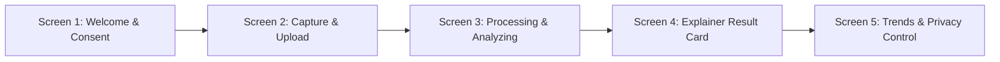

# 04. Design Specification: Screens, States, and Direction

This document defines the complete UI/UX design architecture for **ReportSaathi (Medicine & Health Explainer)**. It is engineered specifically for **older users (aged 40–75)** operating **low-cost Android smartphones** (e.g., Redmi A-series, Samsung Galaxy M0x, 2GB–3GB RAM, 720p/360dp display) across **Indic scripts (Hindi, Kannada) and English**.

Visual screen mockups are stored in [docs/references/](file:///c:/Users/Hp/Documents/report-saathi/docs/references/).

---

## 1. Visual Reference Board

---

## 2. Screen Inventory & State Matrix

### Screen 1: Welcome & DPDP Consent Screen
*Primary Goal: Establish clinical trust, clarify the "explains, not diagnoses" boundary, and obtain explicit DPDP Act 2023 consent.*

* **Default State:**
  * Clean, high-contrast shield icon with trilingual welcome banner: *"Privacy & Simple Explanation / ನಿಮ್ಮ ವರದಿ ಸರಳ ಕನ್ನಡದಲ್ಲಿ"*.
  * Three green benefit chips: (1) Explains, does not diagnose; (2) Identity details scrubbed locally; (3) DPDP 2023 compliant.
  * Three horizontal language selection pills: `[English]`, `[हिंदी]`, `[ಕನ್ನಡ]`.
  * Large, bottom-anchored CTA button (52dp height): `[✅ Agree & Continue (ಒಪ್ಪಿಗೆ)]`.
* **Empty State:**
  * Displays when accessed before language selection: defaults to bilingual English + regional prompt ("Select your language to begin / ಮುಂದುವರಿಯಲು ಭಾಷೆ ಆಯ್ಕೆಮಾಡಿ").
* **Loading State:**
  * Button text changes to `[Logging Consent...]` with a subtle circular indicator; screen dimmed slightly to prevent multiple tap submissions.
* **Error State:**
  * Red alert toast at top: *"Unable to record consent. Please check your internet connection and try again."* Retries without reloading the page.

---

### Screen 2: Capture & Upload Screen
*Primary Goal: Provide foolproof, zero-typing image acquisition for medicine blister strips, printed prescriptions, or lab reports.*

* **Default State:**
  * Yellow guidance pill at the top: *"💡 Tip: Keep the strip or paper flat in good light (ಸ್ಪಷ್ಟ ಫೋಟೋ ತೆಗೆಯಿರಿ)"*.
  * Central camera reticle box with dashed teal borders and large 44dp camera icon.
  * Primary button: `[📸 Take Photo (ಕ್ಯಾಮೆರಾ)]` (56dp tap target).
  * Secondary button: `[📄 Upload PDF or Gallery Image]`.
* **Empty State:**
  * Initial prompt inside reticle: *"Place medicine blister pack or report here. No typing needed."*
* **Loading State:**
  * Local image capture preview displays with an overlaid indeterminate linear progress bar: *"Reading image... / ಚಿತ್ರವನ್ನು ಓದಲಾಗುತ್ತಿದೆ..."*.
* **Error State (Blurry / Low-Confidence Image):**
  * Reticle border turns amber; friendly warning banner appears:
    > *"The photo is blurry or angled (OCR confidence < 55%). Please place the strip flat under a lamp and take a straight-on photo."*
  * Big amber button: `[📸 Retake Photo]`.

---

### Screen 3: Processing & Analyzing Screen
*Primary Goal: Alleviate waiting anxiety, demonstrate local privacy scrubbing, and reassure the patient within 15–20 seconds.*

* **Default / Active State:**
  * Pulsing circular stopwatch icon with clear timing reassurance: *"Please wait 15–20 seconds / ಸ್ವಲ್ಪ ಸಮಯ ಕಾಯಿರಿ..."*.
  * Four animated checkmark steps:
    1. `[✓]` Personal identity details scrubbed locally.
    2. `[✓]` Active chemical molecules / biomarkers identified.
    3. `[⏳]` Creating Kannada & Hindi audio explanation...
    4. `[ ]` Preparing 3 questions for your doctor.
* **Empty State:**
  * N/A (transitional screen triggered immediately after image capture).
* **Loading State:**
  * Sub-text footer: *"🔒 Your image is never stored or shared with external parties."*
* **Error State (Server Timeout / Pipeline Failure):**
  * Replaces checklist with a calm recovery dialog:
    > *"This report format was difficult to read automatically. You can either (1) Try another photo or (2) Forward this directly to our WhatsApp support."*
  * Button: `[🔄 Try Again]`.

---

### Screen 4: Core Result & Explainer Card Screen
*Primary Goal: Deliver jargon-free clinical understanding, audio explanation, and empowerment for the doctor visit.*

* **Default State:**
  * Header showing detected brand & generic molecules: e.g., **Telma-AM (Telmisartan 40mg + Amlodipine 5mg)** with a green "Routine" or amber "Attention" badge.
  * **Prominent Audio Bar:** Large green circular play button, label: `[▶️ Listen in Kannada (ಆಲಿಸಿ) • 0:38]`, playback speed selector (`1.0x / 0.8x` for elders).
  * **Medicine Explainer Card (Plain Metaphors):**
    * *What it does:* Relaxes blood pipes so your heart pumps easily.
    * *How to take:* 1 tablet every morning with or without food.
    * *Normal sensations:* Mild evening ankle swelling.
    * *⚠️ Red Flag Box (Red outline):* Severe facial swelling or fainting $\rightarrow$ Call doctor immediately.
  * **3 Questions for Doctor Card:** High-contrast blue container with 3 numbered, quotable questions.
  * Bottom Action Bar: `[📤 Share to WhatsApp]` and `[🌐 ಕನ್ನಡ / हिंदी]`.
  * Invariant fixed disclaimer banner at bottom.
* **Empty State (Unrecognized Formulation):**
  * If no chronic medicine or biomarker is detected (e.g., user uploaded an invoice or dietary supplement):
    > *"We identified the brand name, but could not verify a clinical chronic medicine salt. Please verify the active ingredients on the back of the strip."*
* **Loading State (Language Switch / Audio Buffer):**
  * Card body displays skeleton loading bars while the cached Kannada or Hindi translation loads ($< 1$ second from cache).
* **Error State (Critical Value Intercept):**
  * If critical biomarker is detected (e.g., Blood Sugar $> 280\text{ mg/dL}$ or extreme hypokalemia):
    * Standard card is replaced with high-visibility Red Emergency Banner:
      > *"⚠️ URGENT CLINICAL ATTENTION: One or more values in this report require prompt doctor evaluation. Please do not wait. Contact your physician or call emergency helpline 112 / 108."*

---

### Screen 5: Past Trends & Privacy Management (`/delete`) Screen
*Primary Goal: Track disease markers across time and provide unconditional DPDP Act data erasure.*

* **Default State:**
  * **Biomarker Trends Card:** Chronological delta chips (e.g., *Fasting Blood Sugar: Oct 12 → Nov 10: ↓ 210 → 175 mg/dL*).
  * **DPDP Act Data Rights Card:** Explanation of user's legal right to total data erasure.
  * High-visibility crimson button: `[🗑️ Permanently Delete All My Data]`.
* **Empty State:**
  * Under trends: *"No past reports on file. Your future test trends will automatically appear here."*
* **Loading State:**
  * While executing deletion: Button disables, text shows: *"Purging database records..."*.
* **Error State (Deletion Confirmation Dialog):**
  * Two-tap confirmation modal to prevent accidental deletion by trembling fingers:
    > *"Are you sure? This will permanently erase your trends, audio files, and report summaries. This cannot be undone."*
    > `[Cancel]` | `[Yes, Erase Everything]`

---

## 3. Design Direction for Older Users & Budget Hardware

### A. Layout
* **Linear, Single-Column Stack:** No multi-column cards, side drawers, or nested horizontal carousels. All content scrolls vertically in one natural thumb motion.
* **Target Viewport:** Strict optimization for **360px width** (the standard CSS viewport for budget 720p Indian Android devices). Zero horizontal scrolling.
* **Thumb-Zone Anchoring:** All high-frequency actions (`Take Photo`, `Play Audio`, `Switch Language`) are positioned in the bottom 40% of the screen.
* **Touch Target Size:** Minimum **$56 \times 56\text{ dp}$** for buttons and **$48\text{ dp}$** for interactive chips, accommodating presbyopia and minor hand tremors.

### B. Typography & Script Handling
* **Typefaces:**
  * English / Latin: System default sans-serif (`Roboto` / `Noto Sans`).
  * Devanagari (Hindi): `Noto Sans Devanagari`.
  * Kannada: `Noto Sans Kannada`.
* **Sizing Scale (Older Eye Optimization):**
  * Primary Headings: **$20\text{ sp} - 22\text{ sp}$**, bold ($700$).
  * Card Titles / Drug Names: **$18\text{ sp}$**, semi-bold ($600$).
  * Body Text: Minimum **$16\text{ sp} - 17\text{ sp}$** (never use $12\text{ sp}$ or $14\text{ sp}$ for instructions).
  * Captions / Disclaimers: **$12\text{ sp} - 13\text{ sp}$** with high contrast.
* **Indic Script Adjustments:**
  * **Line Height:** Must be set to **$1.65\times - 1.8\times$** font size (e.g., `line-height: 28px` on `16px` text). Standard English line-height ($1.2\times$) brutally clips Kannada subscript conjuncts (*vattus*) and Hindi upper vowel modifiers (*matras*).
  * **No Hyphenation:** Disable CSS hyphenation (`hyphens: none`). Indic words (*e.g., Kannada "ರಕ್ತದೊತ್ತಡ" [blood pressure]*) lose phonetic meaning when hyphenated arbitrarily.

### C. Colour Palette (AAA Contrast & Glare Reduction)
* **Background:** Warm off-white (`#F8FAFC` or `#FAFAFA`). Avoid pure `#000000` (harsh OLED halo for cataract patients) and pure `#FFFFFF` (glare).
* **Primary Healthcare Brand:** Calming Deep Teal (`#0F766E` / `#0D9488`). Reassuring, institutional, non-alarming.
* **Body Text:** Dark Slate (`#0F172A`), providing an **$11:1$ contrast ratio** against the background (far exceeding WCAG AAA $7:1$ standard).
* **Audio Action:** Vibrant Emerald Green (`#065F46` on `#34D399`), borrowing direct familiarity from WhatsApp voice notes.
* **Alert & Emergency:** Pure Crimson (`#991B1B` on `#FEF2F2` background). Strictly segregated for genuine medical red flags, never for generic app errors.

### D. Spacing & Hardware Performance
* **8dp Grid System:** Spacing increments of $8\text{ dp}, 16\text{ dp}, 24\text{ dp}$.
* **Low-GPU Optimization:**
  * **Zero Heavy Box-Shadows / Blur Filters:** Budget devices with MediaTek Helio chips stutter when rendering `backdrop-filter: blur()`. Use crisp `1px` or `1.5px solid #E2E8F0` borders instead of shadows.
  * **Vector SVG Assets:** All icons and reticles use lightweight SVGs ($< 2\text{ KB}$ each) to maintain instant 60fps scrolling on 2GB RAM phones.

### E. Tone & Voice
* **Register:** Respectful, gentle, family-oriented ("Grandson explaining to Grandmother").
* **Analogy-First:** E.g., *"Relaxes blood pipes"* instead of *"peripheral vasodilation"*; *"sugar filter"* instead of *"renal nephron clearance"*.
* **Definitive Boundaries:** Never say *"You are cured"* or *"You have disease X"*. Always frame outputs as preparation for the doctor consultation.

---

## 4. Reference Critique: What to Borrow & What to Avoid

### Reference 1: NHS Digital Service Manual (UK)
* **What to Borrow:**
  * The question-oriented informational architecture: *"What it is"*, *"How to take"*, *"Side effects"*.
  * Stark, accessible, high-contrast typography hierarchy.
* **What to Avoid:**
  * Dense, text-heavy desktop layouts that overwhelm mobile users.
  * Lack of native audio/voice note integration.

### Reference 2: Google Material Design for Android Go / NBU
* **What to Borrow:**
  * Bottom-anchored thumb zones and large tactile card boundaries.
  * Low-memory layout standards and offline-ready visual badges.
* **What to Avoid:**
  * Complex nested menus, hidden hamburger drawers, and subtle floating animations that confuse non-tech-savvy elders.

### Reference 3: Indian E-Pharmacies (Tata 1mg / Apollo 24/7)
* **What to Borrow:**
  * Practical juxtaposition of trade brand names vs chemical active salts (vital for Indian prescription reality).
* **What to Avoid:**
  * **Commercial clutter:** Flash sales, countdown discount timers, supplement up-selling banners, and confusing shopping carts that distract from medical understanding.

### Reference 4: Ada Health (Symptom Checker)
* **What to Borrow:**
  * Calm, respectful clinical greeting and step-by-step progress reassurance.
* **What to Avoid:**
  * Exhaustive 25-question interrogations that induce cognitive fatigue and worst-case scenario cyberchondria.

### Reference 5: WhatsApp Native Audio Messaging
* **What to Borrow:**
  * The ubiquitous green circular play button and audio scrubber pattern that 100% of Indian smartphone users over 40 already know how to operate.
  * Direct one-tap forward button to family members.
* **What to Avoid:**
  * Unformatted plain text walls that look like unverified viral WhatsApp forwards. Must maintain clean clinical framing and verification badges.
