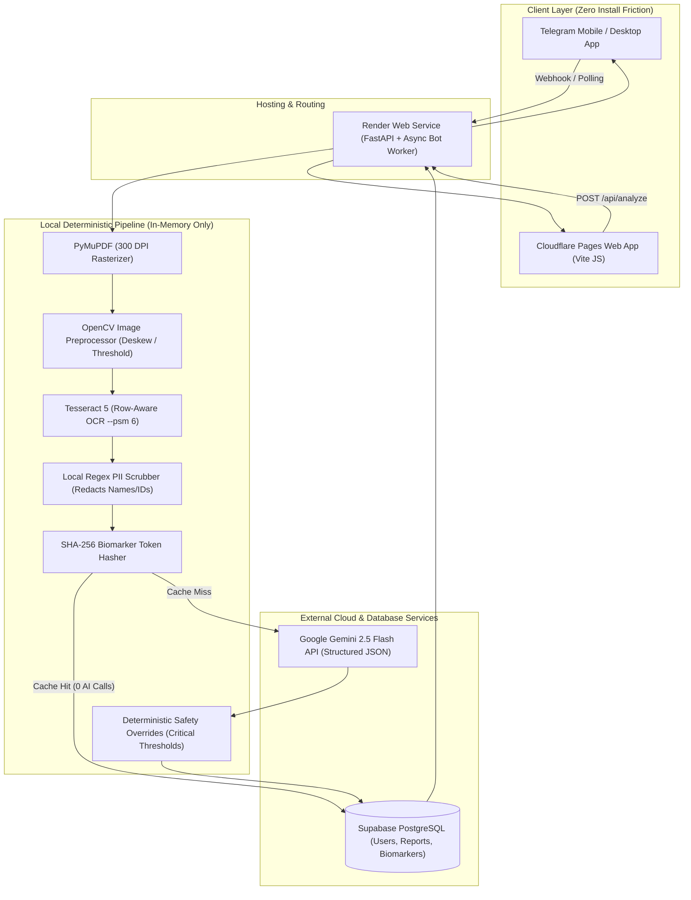

# 06. System Architecture: ReportSaathi

## 1. Architectural Philosophy

The architecture of **ReportSaathi** is governed by three non-negotiable constraints:
1. **Zero Raw Image Persistence:** In strict compliance with India's DPDP Act 2023, patient medical images and unredacted OCR text are processed entirely in ephemeral RAM and never written to persistent disk or cloud object storage.
2. **Deterministic Safety Primacy:** Clinical safety overrides, PII scrubbing, deduplication hashing, and legal disclaimers are executed by deterministic Python algorithms—never delegated to an AI model.
3. **100% Free & Open-Source Foundation:** Designed to run with zero monthly operational infrastructure costs using verified open-source libraries and generous free tiers.

---

## 2. Stack Comparison & Recommendation

To determine the simplest, most resilient architecture, we evaluated two architectural paradigms:

| Architectural Dimension | Option 1: AWS Serverless Microservices | Option 2: Lean Python Service + Free-Tier Cloud (Recommended) |
| :--- | :--- | :--- |
| **Backend & Compute** | AWS Lambda (Python) + API Gateway | **FastAPI (Python 3.11+) hosted on Render (Free Tier)** |
| **OCR & Vision** | AWS Textract ($1.50 per 1,000 pages) | **Tesseract 5 + OpenCV-Headless + PyMuPDF (100% Open-Source / Local)** |
| **AI Model & Logic** | AWS Bedrock (Claude 3.5 Sonnet / Llama 3) | **Google Gemini API (`gemini-2.5-flash` via `google-genai` SDK, Free Tier)** |
| **Database & Auth** | AWS DynamoDB + Cognito | **Supabase (PostgreSQL 15 with Row-Level Security, Free Tier)** |
| **Chat Interface** | Twilio WhatsApp Business API ($0.05/msg) | **Telegram Bot API (Official, 100% Free, Unlimited Webhooks)** |
| **Frontend Hosting** | AWS S3 + CloudFront | **Cloudflare Pages (Vite + Vanilla JS, 100% Free Tier)** |
| **DPDP Compliance Friction** | High: Images stored in S3 buckets require lifecycle purge policies and cross-region compliance. | **Zero:** Images processed exclusively in ephemeral RAM; never touched by a cloud drive. |
| **Monthly Infrastructure Cost** | \$35 – \$120 / month minimum | **\$0.00 / month (Fully viable on free tier)** |

### Architectural Recommendation
**Option 2 is recommended without reservation.**  
Option 1 introduces unnecessary distributed systems complexity (cold starts across multiple Lambda functions, S3 bucket privacy leakage risks, and significant usage fees). Option 2 provides a unified, modular monolith where the Telegram Bot, FastAPI endpoints, and OCR processing pipeline share the exact same battle-tested Python libraries (`ocr_scrub.py`, `gemini_analyzer.py`, `database.py`) in memory.

---

## 3. High-Level System Architecture Diagram



---

## 4. Deterministic Code vs. AI Model Matrix

To prevent hallucinations and guarantee medical safety, the division between deterministic code and AI reasoning is strictly bounded:

| Processing Stage | Mechanism | Engine / Component | Guarantee |
| :--- | :--- | :--- | :--- |
| **Image Deskew & Filtering** | **Deterministic** | `OpenCV` (cv2.adaptiveThreshold, warpAffine) | Normalizes rotation and eliminates shadows. |
| **PDF Page Rasterization** | **Deterministic** | `PyMuPDF` (fitz at 300 DPI) | Crisp text extraction from vector/digital lab PDFs. |
| **Word Grouping into Visual Rows** | **Deterministic** | Python algorithm using vertical centers ($y_c$) | Keeps Test Name, Value, Unit, and Range on one line. |
| **PII & Identity Scrubbing** | **Deterministic** | Python regex rules (`ocr_scrub.py`) | Strips names, phones, emails, UHID, doctor credentials. |
| **Report Hash & Deduplication** | **Deterministic** | `hashlib.sha256` of sorted biomarker lines | Identical uploads return stored data with **zero AI calls**. |
| **Historical Deltas** | **Deterministic** | SQL & Python comparator against past values | Computes exact delta (e.g., $210 \rightarrow 175\text{ mg/dL}$). |
| **Medical Jargon Simplification** | **AI Model** | Google Gemini `gemini-2.5-flash` | Translates raw tests into everyday metaphors (आप/ನೀವು-form). |
| **Cross-Marker Pattern Discovery** | **AI Model** | Google Gemini `gemini-2.5-flash` | Correlates markers (e.g., Low Hb + Low MCV = Iron pattern). |
| **3 Doctor Questions Generation** | **AI Model** | Google Gemini `gemini-2.5-flash` | Formulates exactly 3 patient questions for their doctor visit. |
| **Critical Safety Urgency Overrides** | **Deterministic** | Python `apply_safety_overrides()` | Forces `"Prompt Attention"` if critical rules match. |
| **Invariant Legal Disclaimer** | **Deterministic** | Python constant injection (`DISCLAIMER`) | Invariant text appended; AI is forbidden from writing disclaimers. |
| **Data Erasure (`/delete`)** | **Deterministic** | PostgreSQL `ON DELETE CASCADE` | 100% hard purge of user records from database. |

---

## 5. Supabase Data Model (PostgreSQL DDL)

The data model operates under PostgreSQL with Row Level Security (RLS) enabled. Only the backend server possessing the `SUPABASE_SERVICE_KEY` can read and write data.

```sql
-- Enable cryptographic extensions
create extension if not exists "pgcrypto";

-- 1. Users Table (Stores minimal session identifiers & DPDP consent)
create table users (
  id uuid primary key default gen_random_uuid(),
  telegram_chat_id bigint unique,
  email text unique,
  age int,
  biological_sex text,
  preferred_lang text default 'en' check (preferred_lang in ('en', 'hi', 'kn')),
  consent_at timestamptz,
  created_at timestamptz default now()
);

-- 2. Reports Table (Stores scrubbed summaries and cached translations)
create table reports (
  id uuid primary key default gen_random_uuid(),
  user_id uuid references users(id) on delete cascade,
  report_hash text not null,
  report_date date default current_date,
  urgency_level text check (urgency_level in ('Routine', 'Consult Soon', 'Prompt Attention')),
  summary_en jsonb not null,
  summary_hi jsonb,
  summary_kn jsonb,
  created_at timestamptz default now(),
  unique (user_id, report_hash)
);

-- 3. Biomarkers Table (Stores individual lab/medicine records for trend calculation)
create table biomarkers (
  id uuid primary key default gen_random_uuid(),
  report_id uuid references reports(id) on delete cascade,
  user_id uuid references users(id) on delete cascade,
  test_name text not null,
  observed_value numeric,
  unit text,
  ref_range text,
  status text check (status in ('Normal', 'Low', 'High', 'Borderline')),
  recorded_at date default current_date
);

-- Indexes for lightning-fast hash lookups and trend queries
create index idx_reports_user_hash on reports (user_id, report_hash);
create index idx_biomarkers_user_test on biomarkers (user_id, lower(test_name), recorded_at desc);

-- Enable Row Level Security (Backend Service Role access only)
alter table users enable row level security;
alter table reports enable row level security;
alter table biomarkers enable row level security;
```

---

## 6. API & Route Specifications

### A. FastAPI Backend Routes (`backend/main.py`)

#### 1. Health Probe
* **Endpoint:** `GET /health`
* **Response:** `200 OK` `{"status": "healthy", "service": "ReportSaathi", "version": "1.0.0"}`

#### 2. Telegram Webhook Receiver
* **Endpoint:** `POST /telegram/webhook/{secret_token}`
* **Payload:** Incoming Telegram `Update` JSON.
* **Functionality:** Dispatches updates asynchronously to the `python-telegram-bot` application.

#### 3. Web Client Analysis Endpoint
* **Endpoint:** `POST /api/analyze`
* **Content-Type:** `multipart/form-data`
* **Form Parameters:**
  * `file`: Binary file (image or PDF, max 10MB).
  * `lang`: String (`"en"`, `"hi"`, or `"kn"`).
  * `user_id`: Optional UUID string for authenticated web users.
* **Response (JSON):**
```json
{
  "report_id": "9b1deb4d-3b7d-4bad-9bdd-2b0d7b3dcb6d",
  "urgency": "Routine",
  "specialist": "General Physician",
  "normal_summary": "Complete Blood Count, Kidney and Liver parameters are within standard ranges.",
  "abnormal": [
    {
      "test": "HbA1c",
      "value": "7.8 %",
      "status": "High",
      "explanation": "Your average three-month sugar level is slightly elevated above standard targets.",
      "trend_note": "Was 8.4% three months ago (improved)."
    }
  ],
  "cross_marker_patterns": [],
  "doctor_questions": [
    "Does my improved HbA1c mean my current medicine dosage is working well?",
    "Should we recheck my fasting blood sugar in 6 or 12 weeks?",
    "Do I need any additional adjustments to my morning diet?"
  ],
  "disclaimer": "This explains your report in simple words. It is not a diagnosis. Please show the report to your doctor."
}
```

---

## 7. Authentication & Security Model

1. **Telegram Client Authentication:**  
   * Authenticated by unique Telegram `chat_id`.  
   * Webhook security guaranteed via URL route entropy: `/telegram/webhook/{WEBHOOK_SECRET}`.
2. **Database Authentication:**  
   * Handled server-side through Supabase Python client using `SUPABASE_SERVICE_KEY`.  
   * No database connection strings or keys are exposed to the client or checked into Git.
3. **Web Client CORS Policy:**  
   * Restricted strictly to the deployed Cloudflare Pages domain via `CORS_ORIGIN` environment variable.

---

## 8. Third-Party Services & Dependencies

All integrated third-party libraries and APIs operate under open-source licenses or zero-cost developer tiers:

| Service / Tool | Purpose | License / Tier |
| :--- | :--- | :--- |
| **pytesseract** | Python wrapper for Tesseract OCR | Apache 2.0 (Open Source) |
| **opencv-python-headless** | Computer vision image deskewing and thresholding | Apache 2.0 (Open Source) |
| **PyMuPDF (fitz)** | High-resolution PDF rasterization | AGPL / Python Package (Open Source) |
| **python-telegram-bot (v21+)**| Async Telegram Bot event handling | LGPLv3 (Open Source) |
| **google-genai** | Official Google GenAI SDK for Gemini 2.5 Flash | Apache 2.0 (Free API Quota: 15 RPM) |
| **supabase-py** | Client for PostgreSQL database interactions | MIT (Free Tier) |
| **gTTS (Google TTS)** | Spoken vernacular audio voice note generation | MIT (Open Source / Free) |

---

## 9. Environment Variables (`.env.example`)

```bash
# Gemini API Configuration
GEMINI_API_KEY=your_gemini_api_key_here

# Telegram Bot Credentials
TELEGRAM_BOT_TOKEN=your_telegram_bot_token_here
WEBHOOK_SECRET=your_random_secure_webhook_secret_here

# Supabase PostgreSQL Configuration
SUPABASE_URL=https://your-project.supabase.co
SUPABASE_SERVICE_KEY=your_supabase_service_role_key_here

# Deployment & Routing
WEBHOOK_BASE_URL=https://reportsaathi.onrender.com
CORS_ORIGIN=https://reportsaathi.pages.dev

# Local Tesseract Path (Windows Dev Only; not required on Linux/Render)
TESSERACT_CMD=C:\Program Files\Tesseract-OCR\tesseract.exe
```

---

## 10. Open Questions & Technical Unknowns

Rather than guessing, the following technical and operational uncertainties require real-world testing:

1. **Telegram Audio File Upload Limits vs. In-Memory Streaming:**  
   * *Question:* When generating Kannada audio voice notes using `gTTS`, can we pipe audio bytes directly via `send_voice` using `io.BytesIO` on Render without hitting memory spike limits during concurrent requests?
2. **Render Free-Tier Ephemeral Sleep Cycle:**  
   * *Question:* Render free-tier instances spin down after 15 minutes of inactivity, causing a 40–50 second cold start on the first incoming Telegram webhook. Is an external keep-alive ping (e.g., Cron-job.org every 10 mins) acceptable, or should we run the bot in long-polling mode during initial user testing?
3. **Regional OCR Accuracy on Carbon-Copy Prescriptions:**  
   * *Question:* Tesseract `--psm 6` performs reliably on digital and printed reports, but handwritten doctor prescriptions in India frequently score confidence $< 30\%$. Should the product strictly gate scope to **printed lab reports and blister pack strips**, explicitly turning away handwritten doctor notes?
