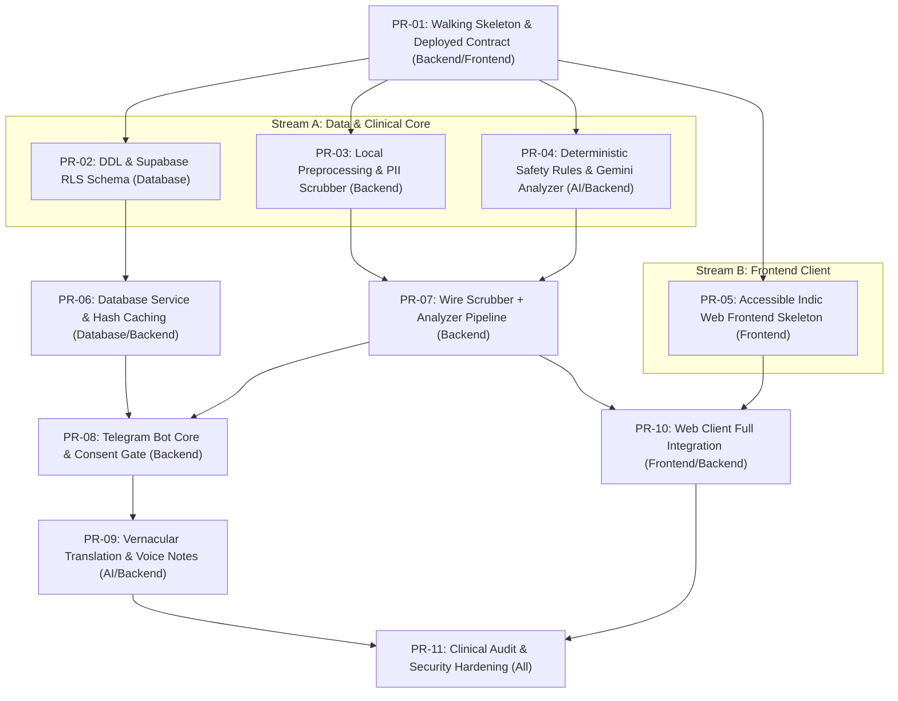

# 08. Engineering Task List: ReportSaathi

This document breaks down the development of **ReportSaathi** into ordered, bite-sized tasks. Each task is sized for a single reviewable Pull Request (PR) and contains explicit ownership, mapped requirements, test criteria, dependencies, and Definition of Done (DoD).

---

## 1. Execution Dependency & Parallelism Graph

---

## 2. Granular Task Breakdown

### Milestone 0: Walking Skeleton & Foundation

#### Task PR-01: Deployed Walking Skeleton & API Contracts
* **Owner:** `backend` + `frontend`
* **Requirements:** `FR-2.1`, `NFR-1`, `NFR-5`
* **Test Cases:** `TC-FR-2.1` (Contract test: `GET /health` returns 200 OK)
* **Dependencies:** None
* **Human Approval Required:** ⚠️ **YES** (Provisioning Render free-tier and Cloudflare Pages projects)
* **Scope:**
  * Initialize repository structure (`backend/`, `frontend/`, `shared/`, `docs/`, `tests/`).
  * Scaffold minimal FastAPI app in `backend/main.py` serving `GET /health` and `GET /api/health` with database health verification.
  * Scaffold minimal Vite + TypeScript in `frontend/` displaying ReportSaathi status and value read from database.
  * Configure Render deployment blueprint (`render.yaml`, `backend/Dockerfile`) and Cloudflare Pages configuration (`frontend/wrangler.toml`).
  * Configure CI pipeline (`.github/workflows/ci.yml`) with linting (Ruff, ESLint), type checking (MyPy, tsc), and automated smoke tests (pytest, vitest).
* **Definition of Done (DoD):**
  - [x] Repository scaffolding completed with `backend/`, `frontend/`, and `shared/`.
  - [x] Automated smoke tests passing for backend (`pytest backend/tests/test_health_smoke.py`) and frontend (`vitest`).
  - [x] Linting and type checking active and passing across both stacks.
  - [x] CI pipeline configured in `.github/workflows/ci.yml`.
  - [x] Staging deployment blueprints configured (`render.yaml`, `wrangler.toml`).
  - [x] `.env.example` committed; no secrets checked into git.
  - [ ] Human approval & staging provisioning: deploy backend to Render free-tier (`GET https://reportsaathi-backend.onrender.com/health` returns 200 OK).
  - [ ] Cloudflare Pages serves live static page with green status badge connecting to deployed backend.

---

### Milestone 1: Local In-Memory OCR & Privacy Engine

#### Task PR-02: Supabase Schema DDL & Row Level Security
* **Owner:** `database`
* **Requirements:** `FR-1.2`, `FR-5.4`, `NFR-4`, `SR-3`
* **Test Cases:** `TC-FR-1.2` (Consent timestamp), `TC-FR-5.3` (Cascade deletion)
* **Dependencies:** PR-01
* **Human Approval Required:** ⚠️ **YES** (Running SQL script in production Supabase editor)
* **Can run in parallel with:** PR-03, PR-04, PR-05
* **Scope:**
  * Implement tables: `users`, `reports`, `biomarkers` as specified in [06-architecture.md](file:///c:/Users/Hp/Documents/report-saathi/docs/06-architecture.md).
  * Configure foreign keys with `ON DELETE CASCADE`.
  * Add compound indexes: `idx_reports_user_hash` and `idx_biomarkers_user_test`.
  * Enable Row Level Security (RLS) restricting all access to `service_role`.
* **Definition of Done (DoD):**
  - [x] Schema DDL created at `supabase/schema.sql` with tables `users`, `reports`, `biomarkers`, cascade foreign keys, compound indexes, and RLS enabled.
  - [x] Automated test suite added in `backend/tests/test_schema.py` verifying DDL syntax, constraints, `TC-FR-1.2` (consent timestamp), and `TC-FR-5.3` (cascade deletion).
  - [ ] Human Approval Gateway (GATE-2): Execute `supabase/schema.sql` in production Supabase SQL Editor.
  - [ ] Live verification: Deleting a dummy user cascades and deletes linked report and biomarker rows in live Supabase.

#### Task PR-03: Image Preprocessing, Quality Gate & Local PII Scrubbing
* **Owner:** `backend`
* **Requirements:** `FR-2.2`, `FR-2.3`, `FR-2.4`, `FR-3.1`, `FR-3.2`, `FR-3.3`
* **Test Cases:** `TC-FR-2.1`, `TC-FR-2.3`, `TC-FR-3.1`, `TC-FR-3.2`, `TC-FR-3.3`
* **Dependencies:** PR-01
* **Human Approval Required:** No
* **Can run in parallel with:** PR-02, PR-04, PR-05
* **Scope:**
  * Implement `preprocess(image_bytes)` in `backend/ocr_scrub.py` (grayscale, adaptive threshold, deskew).
  * Implement PyMuPDF rasterization for multi-page PDFs at 300 DPI.
  * Implement `ocr_rows()` with Tesseract `--psm 6`, grouping words by vertical centers ($y_c$).
  * Add quality gate: flag `low_quality = True` when average confidence $< 55.0$.
  * Implement `scrub_pii()` redacting names, phones, UHIDs, addresses, and doctor credentials to `[REDACTED]`.
  * Extract `age` and `biological_sex` into isolated variables.
* **Definition of Done (DoD):**
  - [x] `pytest tests/test_scrub.py` passes against `tests/fixtures/report-08-heavy-pii-header.txt` (0 PII tokens survive).
  - [x] `report-09-blurry-low-confidence.txt` returns `low_quality=True`.
  - [x] Original image buffers are cleared from memory post-OCR.

---

### Milestone 2: Deterministic Safety & Structured AI Analysis

#### Task PR-04: Deterministic Critical Overrides & Structured Gemini Analyzer
* **Owner:** `AI` + `backend`
* **Requirements:** `FR-4.1`, `FR-4.2`, `FR-4.3`, `FR-4.4`, `SR-1`, `SR-2`
* **Test Cases:** `TC-FR-4.1`, `TC-FR-4.2`, `TC-FR-4.3`, `TC-FR-4.4`, `TC-FR-4.5`, `TC-FR-4.6`, `TC-SEC-1`
* **Dependencies:** PR-01
* **Human Approval Required:** ⚠️ **YES** (Physician sign-off on `CRITICAL_RULES` threshold values)
* **Can run in parallel with:** PR-02, PR-03, PR-05
* **Scope:**
  * Implement `ReportSummary` Pydantic schema in `backend/gemini_analyzer.py`.
  * Implement `apply_safety_overrides()` evaluating the `CRITICAL_RULES` table.
  * Implement directional urgency enforcement (urgency can only escalate).
  * Configure `google-genai` SDK with `gemini-2.5-flash` using `response_schema=ReportSummary`.
  * Inject hard-coded trilingual `DISCLAIMER` strings.
* **Definition of Done (DoD):**
  - [x] `pytest tests/test_safety.py` passes against `report-02-critical-glucose.txt`, `report-03-critical-anemia.txt`, and `report-05-critical-thrombocytopenia-dengue.txt`.
  - [x] All critical fixtures force `urgency = "Prompt Attention"`.
  - [x] `report-10-adversarial-jailbreak-prescription.txt` outputs valid JSON without diagnosing cancer or altering doses.

---

### Milestone 3: Database Persistence & Cache-First Hashing

#### Task PR-05: Database Service & SHA-256 Deduplication Caching
* **Owner:** `backend` + `database`
* **Requirements:** `FR-1.2`, `FR-3.4`, `FR-5.1`, `FR-5.3`, `FR-5.4`, `NFR-1`
* **Test Cases:** `TC-FR-1.2`, `TC-FR-3.4`, `TC-FR-5.2`, `TC-FR-5.3`, `TC-SEC-2`
* **Dependencies:** PR-02
* **Human Approval Required:** No
* **Can run in parallel with:** PR-03, PR-04
* **Scope:**
  * Implement `backend/database.py` with `supabase-py` client using service role key.
  * Implement `get_or_create_user()`, `set_consent()`, `set_language()`.
  * Implement `find_report_by_hash(user_id, report_hash)` and `save_report()`.
  * Implement `compute_deltas(current_rows, history)` for trend notes.
  * Implement `delete_user_data(chat_id)` executing hard cascading delete.
* **Definition of Done (DoD):**
  - [x] `pytest tests/test_database.py` smoke test passes on a test user.
  - [x] Uploading identical report twice returns stored row with 0 LLM calls.
  - [x] `delete_user_data()` purges all linked records in Supabase.

---

### Milestone 4: Integration Pipeline & Telegram Bot Delivery

#### Task PR-06: End-to-End Core Pipeline Wiring
* **Owner:** `backend`
* **Requirements:** `FR-3.4`, `FR-4.1`, `FR-4.3`, `NFR-1`
* **Test Cases:** `TC-FR-2.1`, `TC-FR-3.4`, `TC-FR-4.2`
* **Dependencies:** PR-03, PR-04, PR-05
* **Human Approval Required:** No
* **Scope:**
  * Wire `ocr_scrub.py` $\rightarrow$ `database.py` (hash check) $\rightarrow$ `gemini_analyzer.py` $\rightarrow$ `safety_overrides` $\rightarrow$ `database.save_report()`.
  * Expose synchronous `POST /api/analyze` in `backend/main.py`.
  * Ensure comprehensive error handling for blurry images and unparseable rows.
* **Definition of Done (DoD):**
  - [x] `POST /api/analyze` accepts `report-01-routine-cbc.txt` and returns valid `ReportSummary` JSON in $<20$ seconds.
  - [x] Re-posting the same file returns in $<1.5$ seconds from cache.

#### Task PR-07: Telegram Bot Asynchronous Event Handler
* **Owner:** `backend`
* **Requirements:** `FR-1.1`, `FR-1.2`, `FR-1.3`, `FR-5.4`
* **Test Cases:** `TC-FR-1.1`, `TC-FR-1.2`, `TC-FR-5.3`
* **Dependencies:** PR-06
* **Human Approval Required:** ⚠️ **YES** (Registering Telegram bot handle with @BotFather)
* **Scope:**
  * Implement `backend/bot.py` with `python-telegram-bot` (v21+, async).
  * Implement `/start` workflow with consent keyboard (`[✅ I Agree & Continue]`).
  * Implement file intake (`filters.PHOTO | filters.Document.PDF`).
  * Reply immediately with "Analyzing... ⏳", then edit message with final summary card.
  * Attach inline action keyboard: `[🇮🇳 हिंदी]`, `[🇮🇳 ಕನ್ನಡ]`, `[📈 Trends]`, `[🗑️ Delete My Data]`.
  * Implement `/delete` command with two-step confirmation.
* **Definition of Done (DoD):**
  - [x] Direct photo upload in Telegram returns formatted card within 25s.
  - [x] `/delete` purges user data and confirms in chat.

#### Task PR-08: Vernacular Localization & Audio Voice Notes
* **Owner:** `AI` + `backend`
* **Requirements:** `FR-5.1`, `FR-5.2`, `NFR-3`
* **Test Cases:** `TC-FR-1.3`, `TC-FR-5.1`
* **Dependencies:** PR-07
* **Human Approval Required:** ⚠️ **YES** (Review of Hindi and Kannada conversational audio register)
* **Scope:**
  * Implement `translate(summary_en, target_lang)` in `gemini_analyzer.py` using "grandson-to-grandmother" prompt.
  * Cache `summary_hi` and `summary_kn` in `reports` table; fetch from cache on subsequent taps.
  * Integrate audio generation (`gTTS` or verified pre-recorded audio snippets).
  * Send audio via Telegram `send_voice` on `lang:*` callback triggers.
* **Definition of Done (DoD):**
  - [x] Tapping `[🇮🇳 ಕನ್ನಡ]` renders Kannada text card and voice note.
  - [x] Tapping `[🇮🇳 ಕನ್ನಡ]` a second time triggers 0 Gemini calls (verified in logs).

---

### Milestone 5: Accessible Indic Web Frontend

#### Task PR-09: Single-Column Responsive Indic Web Client
* **Owner:** `frontend`
* **Requirements:** `FR-1.1`, `FR-1.3`, `FR-2.1`, `NFR-2`, `NFR-3`, `NFR-6`
* **Test Cases:** `TC-FR-1.1`, `TC-FR-2.1`
* **Dependencies:** PR-01 (Can use mock JSON during initial development)
* **Human Approval Required:** No
* **Can run in parallel with:** PR-06, PR-07
* **Scope:**
  * Build responsive single-column layout in `frontend/index.html` and `main.js` targeting 360dp width.
  * Implement high-contrast typography using `Noto Sans Devanagari` and `Noto Sans Kannada` with line-height $1.7\times$.
  * Enforce minimum 56dp tap targets for buttons.
  * Implement 4 UI states for all screens: Default, Empty, Loading (spinner + reassurance), and Error.
  * Add language selection pills and fixed disclaimer banner.
* **Definition of Done (DoD):**
  - [ ] Chrome DevTools 360px mobile emulation shows zero horizontal overflow.
  - [ ] Lighthouse Accessibility score $\ge 95$ (WCAG AAA contrast verified).

#### Task PR-10: Web Client API Integration & Audio Playback
* **Owner:** `frontend` + `backend`
* **Requirements:** `FR-2.1`, `FR-4.2`, `FR-5.1`, `NFR-1`
* **Test Cases:** `TC-FR-2.1`, `TC-FR-3.4`
* **Dependencies:** PR-06, PR-09
* **Human Approval Required:** No
* **Scope:**
  * Wire file upload dropzone to `POST /api/analyze`.
  * Render `ReportSummary` JSON into result card (Normal summary, Abnormal markers, 3 Doctor Questions).
  * Integrate HTML5 Web Audio player with 0.8x/1.0x playback speed toggles.
  * Configure CORS for Cloudflare Pages domain in `backend/main.py`.
* **Definition of Done (DoD):**
  - [ ] Uploading a lab PDF on the web interface displays result card within 20s.
  - [ ] Switching language toggles between English, Hindi, and Kannada.

---

### Milestone 6: Hardening & Clinical Verification

#### Task PR-11: Clinical Verification & Statutory Security Audit
* **Owner:** `AI` + `backend` + `database`
* **Requirements:** `SR-1`, `SR-2`, `SR-3`, `SR-4`, `NFR-4`, `NFR-5`
* **Test Cases:** `TC-SEC-1`, `TC-SEC-2`, `TC-SEC-3`
* **Dependencies:** PR-08, PR-10
* **Human Approval Required:** ⚠️ **YES** (Clinical Advisory Review & Legal DPDP Checklist Sign-off)
* **Scope:**
  * Run adversarial test suite against `report-10-adversarial-jailbreak-prescription.txt`.
  * Validate rate limit handling with simulated HTTP 429 backoff.
  * Conduct clinical audit with 2 practicing General Physicians on generated doctor questions.
  * Verify DPDP compliance checklist: zero images on disk, verified `/delete` purge, unambiguous consent.
* **Definition of Done (DoD):**
  - [ ] 100% of tests in `docs/07-test-plan.md` pass in CI pipeline.
  - [ ] Sign-off received from clinical reviewer on prompt safety and critical overrides.
  - [ ] Final production deployment tag created.

---

## 3. Human Approval Gateways

| Gateway ID | Stage | Required Reviewer | Approval Focus |
| :--- | :--- | :--- | :--- |
| **GATE-1** | Pre-PR-01 | DevOps / Tech Lead | Approval of Render and Cloudflare free-tier account setups. |
| **GATE-2** | PR-02 | Database Admin | Supabase DDL execution and RLS policy verification. |
| **GATE-3** | PR-04 | **Physician / Clinician** | Clinical validation of `CRITICAL_RULES` thresholds (e.g., Hb $<7.0$, Glucose $>250$). |
| **GATE-4** | PR-07 | Product / Compliance | Telegram bot registration and verification of DPDP consent copy. |
| **GATE-5** | PR-08 | Native Linguists | Spoken register verification of Hindi and Kannada translations (Grandson-to-Grandmother tone). |
| **GATE-6** | PR-11 | **Medical & Legal Lead** | Formal sign-off on non-diagnostic educational boundaries and DPDP Act compliance. |
