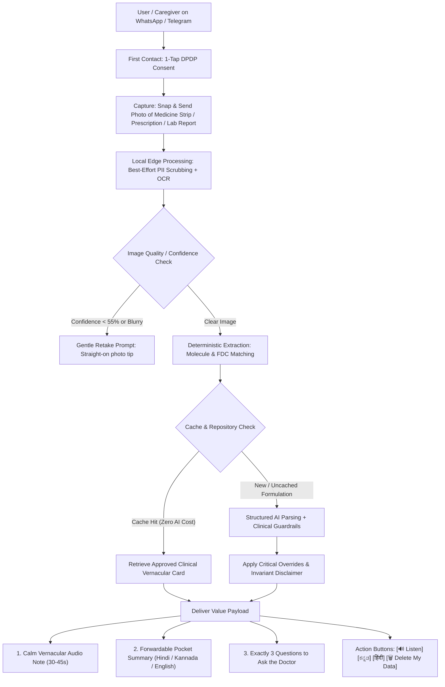

# Core User Flow: From Interaction to Clinical Value

This document outlines the end-to-end interaction flow of **ReportSaathi (Medicine & Health Explainer)**, designed for adults over 40 and their family caregivers. It translates complex prescriptions, medicine strips, and diagnostic reports into calm, vernacular audio and plain-text summaries without diagnosing or hallucinating.

---

## 1. High-Level Architecture & Flow



---

## 2. Step-by-Step User Journey

### Step 1: Zero-Friction Entry & DPDP Consent
* **Channel:** WhatsApp or Telegram Bot (no app installation, zero login friction).
* **Trigger:** User scans a clinic/pharmacy QR code or receives a referral link from a relative.
* **Consent Screen (DPDP Act 2023 Compliant):**
  * The bot sends a single, concise consent card in English and local languages:
    > *"Welcome to ReportSaathi. We explain medicines and lab reports in simple words for your family. We do not diagnose. Your personal details are stripped before processing. You can delete your records anytime with `/delete`."*
  * **User Action:** Taps `[✅ I Agree & Continue]`. Timestamp is logged in the database.

---

### Step 2: Friction-Free Input Capture
* **User Dilemma:** Adults over 40 cannot easily type complex chemical names (*e.g., Telmisartan, Hydrochlorothiazide*).
* **The Solution:** **Camera-first input.**
  * User snaps a photo of the **medicine blister pack**, **printed prescription**, or **lab report**.
  * Alternatively, forwards a PDF report downloaded from a diagnostic lab.

---

### Step 3: Local Privacy Scrubbing & OCR Normalization
* **PIVOT Rule:** No personal identifiers ever leave the local execution layer.
1. **Image Pre-processing:** Grayscale conversion, adaptive thresholding, and deskewing via OpenCV.
2. **PII Scrubbing:** Local regex wipes patient name, phone numbers, UHID, lab barcodes, doctor names, and clinic addresses (`[REDACTED]`). Retains only: age, biological sex, and active medication/biomarker rows.
3. **Quality Gate:** If average OCR confidence is $< 55\%$, the bot halts and replies:
   > *"The photo is a bit blurry or angled. Please send a flat, straight-on photo with good lighting so we don't miss any medicine details."*

---

### Step 4: Deterministic Formulation & Molecule Matching
* **Handling Brand Proliferation & FDCs:**
  * Rather than open-ended LLM guessing, OCR tokens are mapped against an accredited database of top molecules and Fixed-Dose Combinations (FDCs) (e.g., *Amlodipine + Telmisartan*).
  * **SHA-256 Hash Matching:** If this exact molecule/report has been verified previously, the system serves the cached vernacular payload with **0 AI compute cost** and zero risk of hallucination.

---

### Step 5: Clinical Safety Overrides & Static Disclaimer Injection
* **Safety Filter:** If an extracted biomarker or drug dosage exceeds critical thresholds (e.g., Fasting Glucose $> 280\text{ mg/dL}$, Hemoglobin $< 7.0\text{ g/dL}$, or sudden double-dosing query), the system overrides the urgency level to **"Prompt Medical Attention"**.
* **Fixed Invariant Disclaimer:** Automatically appended in code (never generated by AI):
  * **English:** *"This explains your report in simple words. It is not a diagnosis. Please show the report to your doctor."*
  * **Hindi:** *"यह आपकी रिपोर्ट को आसान शब्दों में समझाता है। यह कोई निदान नहीं है। कृपया रिपोर्ट अपने डॉक्टर को दिखाएं।"*
  * **Kannada:** *"ಇದು ನಿಮ್ಮ ವರದಿಯನ್ನು ಸರಳ ಪದಗಳಲ್ಲಿ ವಿವರಿಸುತ್ತದೆ. ಇದು ರೋಗನಿರ್ಣಯವಲ್ಲ. ದಯವಿಟ್ಟು ವರದಿಯನ್ನು ನಿಮ್ಮ ವೈದ್ಯರಿಗೆ ತೋರಿಸಿ."*

---

### Step 6: Delivery of the Core Value Payload
Within 15–25 seconds of upload, the user receives three tailored artifacts:

#### 1. Forwardable WhatsApp/Telegram Text Card
```text
🌿 Medicine Explainer: Telma-AM (Telmisartan 40mg + Amlodipine 5mg)

• What it does: Relaxes your blood pipes so your heart doesn't have to pump as hard, keeping blood pressure steady.
• How to take: Once a day, usually in the morning, with or without food. Try to take it at the same time each day.
• What is normal: Mild ankle swelling or slight dizziness when standing up quickly.
• ⚠️ Red Flags: Severe dizziness, fainting, or swelling of lips/face -> Contact your doctor immediately.

Personal details removed (best effort).
This explains your report in simple words. It is not a diagnosis. Please show the report to your doctor.
```

#### 2. Vernacular Audio Note (30–45 Seconds)
* Generated via pre-recorded high-quality audio or verified TTS in **Hindi, Kannada, or English**.
* Perfect for aging parents who prefer listening over reading English text on a small screen.

#### 3. Exactly 3 Questions to Ask the Doctor
Empowers the patient during their next 5-minute consultation:
1. *"My ankles feel slightly swollen in the evenings—is that expected with this tablet?"*
2. *"Should I get my kidney function and potassium tested after 3 months on this medicine?"*
3. *"If I miss a morning dose, should I take it in the evening or wait until the next day?"*

---

## 3. Post-Delivery Controls & DPDP Compliance

Below each message, an interactive keyboard provides immediate user control:

| Button | Action |
| :--- | :--- |
| `[🔊 Listen (Audio)]` | Sends the voice note in the active language. |
| `[हिंदी / ಕನ್ನಡ]` | Re-renders the card and audio in Hindi or Kannada instantly. |
| `[📈 Past Trends]` | Shows how this reading or prescription compares to their previous report. |
| `[🗑️ Delete My Data]` | Executes an immediate hard delete (`ON DELETE CASCADE`) of all stored records and confirms deletion. |

---

## 4. Edge Cases and Fallback Matrix

| Scenario / Edge Case | Failure Mode | System Response / Fallback |
| :--- | :--- | :--- |
| **Unrecognized Medicine Brand** | Brand is obscure or chemist-specific. | Extracts the chemical salt print (*small text below brand*). If still ambiguous, returns: *"We couldn't clearly verify the active molecule. Please check the back of the strip or ask your chemist."* |
| **Multiple Conflicting Drugs Uploaded** | Risk of Drug-Drug Interaction. | Explains each drug individually, appends warning: *"You are taking multiple medications together. Ask your doctor or pharmacist to confirm they do not interact."* |
| **Severe Panic Symptoms Entered** | Patient asks about chest pain or numbness. | Emergency Intercept: Suppresses standard explanation, outputs local emergency helpline (112/108) and advises immediate hospital visit. |
| **User Revokes Consent** | User sends `/delete`. | Instantly purges user profile, past reports, and chat logs from Supabase; confirms with a zero-retention receipt. |
